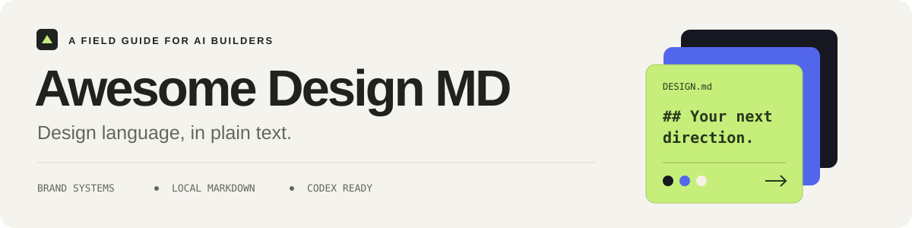
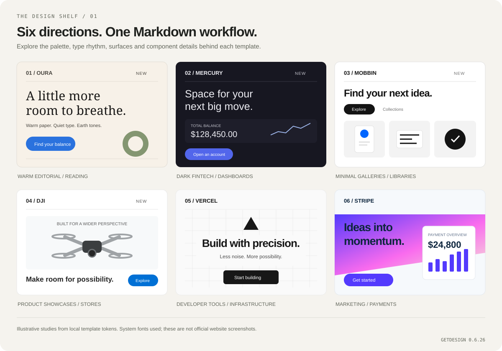

<div align="center">



# Awesome Design MD

**把品牌设计语言，变成 AI 可以直接使用的 Markdown。**

86 个品牌设计模板 · 本地使用 · 支持 Codex 与 Antigravity

[](awesome-design-md/references/templates/manifest.json) [](https://www.npmjs.com/package/getdesign) [](https://github.com/taffy-owo/codex-skill-awesome-design-md/actions/workflows/test.yml) [](LICENSE)

**中文** / [English](README_EN.md)

[设计预览](#设计预览) · [快速开始](#快速开始) · [选择风格](#选择风格) · [完整模板](#完整模板) · [维护与同步](#维护与同步)

</div>

## 从一个设计方向开始

为落地页、仪表盘、内容产品和组件挑选一份 `DESIGN.md`，让 AI 编码助手据此实现颜色、字体、间距、组件和响应式布局。模板来自 [VoltAgent/awesome-design-md](https://github.com/VoltAgent/awesome-design-md) 的官方 [`getdesign`](https://www.npmjs.com/package/getdesign) 包，本次快照为 **0.6.26，共 86 个模板**。

| 选一个方向 | 写入项目 | 开始实现 |
| --- | --- | --- |
| 按产品和视觉气质浏览模板 | CLI 将模板保存为 `DESIGN.md` | 让助手先阅读规范，再修改界面 |

应用已有模板时无需 API Key 或网络。只有安装技能、同步上游时需要联网。

## 设计预览



上图根据本地模板的配色和组件规则绘制，使用系统字体代替品牌字体，是风格示意。点击下面的模板链接可阅读完整规范。

### 本次新增，值得借鉴

| 模板 | 可以借鉴什么 | 适合用在哪里 |
| --- | --- | --- |
| [Oura](awesome-design-md/references/templates/oura.md) | 暖纸底色、衬线标题、自然色与安静留白 | 阅读、生活方式、内容首页 |
| [Mercury](awesome-design-md/references/templates/mercury.md) | 墨紫深色表面、靛蓝行动按钮、轻量排版 | 仪表盘、金融与专业工具 |
| [Mobbin](awesome-design-md/references/templates/mobbin.md) | 白底图库、黑白层级、胶囊筛选与蓝色点缀 | 素材库、作品集、模板浏览 |
| [DJI](awesome-design-md/references/templates/dji.md) | 产品展示分区、工程蓝按钮、清晰规格层级 | 产品介绍、电商与设备展示 |
| [NerdWallet](awesome-design-md/references/templates/nerdwallet.md) | 深绿与薄荷色、紧凑比较布局 | 对比、筛选与决策页面 |
| [Discord](awesome-design-md/references/templates/discord.md) | 深靛蓝、醒目大标题与 Blurple 渐变 | 社区与活动落地页 |
| [Nintendo 2001](awesome-design-md/references/templates/nintendo-2001.md) | Y2K 金属面板、琥珀导航与像素气质 | 复古主题与创意专题 |

另外新增 `1win`、`aljazeera`、`jobright`、`mydealz`、`oracle`、`sap`；全部 13 个新增品牌均已纳入本地清单。`notion` 和 `vercel` 也随本次上游包更新。

## 快速开始

需要 **Python 3.10+**。以下 CLI 命令都在**仓库根目录**执行，日常使用无需安装 Python 依赖。

```bash
git clone https://github.com/taffy-owo/codex-skill-awesome-design-md.git
cd codex-skill-awesome-design-md

# 查找模板
python awesome-design-md/scripts/apply_template.py list --match oura

# 为你的项目写入 DESIGN.md
python awesome-design-md/scripts/apply_template.py install oura --project /path/to/your-project
```

然后告诉你的编码助手：

> 先阅读项目根目录的 DESIGN.md，依据其中的颜色、排版、间距与组件规则优化界面，保留现有功能，并检查窄屏布局和键盘操作。

`--project` 请替换成你的项目路径；Windows 路径包含空格时加引号。已有 `DESIGN.md` 会受到保护，只有明确要替换时才加 `--force`。

### 安装为 Codex 技能

在 Codex 中直接发送：

```text
使用 skill-installer，从 taffy-owo/codex-skill-awesome-design-md 安装 awesome-design-md 技能。
```

也可以将仓库中的 `awesome-design-md/` 目录复制到你配置的 Codex skills 目录。安装后重启 Codex。

<details>
<summary>Antigravity 与更多 CLI 用法</summary>

安装到 Antigravity（在仓库根目录执行）：

```bash
python awesome-design-md/scripts/install_to_antigravity.py
python awesome-design-md/scripts/install_to_antigravity.py --antigravity-home /path/to/antigravity
```

完整列表、JSON 输出、指定文件位置与覆盖：

```bash
python awesome-design-md/scripts/apply_template.py list
python awesome-design-md/scripts/apply_template.py list --json
python awesome-design-md/scripts/apply_template.py install linear --out /path/to/project/docs/DESIGN.md
python awesome-design-md/scripts/apply_template.py install stripe --project /path/to/project --force
```

支持 `linear` → `linear.app`、`mistral` → `mistral.ai`、`xai` → `x.ai` 等别名。

</details>

## 选择风格

| 你的项目 | 建议先看 | 选择理由 |
| --- | --- | --- |
| 书屋、阅读器、内容产品 | [Oura](awesome-design-md/references/templates/oura.md) · [Notion](awesome-design-md/references/templates/notion.md) · [WIRED](awesome-design-md/references/templates/wired.md) | 从留白、阅读层级与编辑排版入手 |
| 开发者工具、基础设施 | [Vercel](awesome-design-md/references/templates/vercel.md) · [Warp](awesome-design-md/references/templates/warp.md) | 结构精确、技术内容清晰 |
| SaaS 与工作台 | [Linear](awesome-design-md/references/templates/linear.app.md) · [Cal](awesome-design-md/references/templates/cal.md) | 低干扰与高效的信息层级 |
| 暗色仪表盘 | [Mercury](awesome-design-md/references/templates/mercury.md) · [Supabase](awesome-design-md/references/templates/supabase.md) | 表面层级与克制的强调色 |
| 图库、书架、资源浏览 | [Mobbin](awesome-design-md/references/templates/mobbin.md) · [Pinterest](awesome-design-md/references/templates/pinterest.md) | 集合浏览、筛选与视觉展示 |
| 营销与产品介绍 | [Stripe](awesome-design-md/references/templates/stripe.md) · [DJI](awesome-design-md/references/templates/dji.md) · [Framer](awesome-design-md/references/templates/framer.md) | 叙事节奏、行动入口与产品展示 |

这些是针对产品场景的选型建议。优先保留项目已有设计系统，按需借鉴；品牌字体使用前需确认许可与可用替代字体。

## 完整模板

<details>
<summary>展开查看 86 个品牌</summary>

### AI 与 LLM 平台

`claude` · `cohere` · `elevenlabs` · `jobright` · `minimax` · `mistral.ai` · `ollama` · `opencode.ai` · `replicate` · `runwayml` · `together.ai` · `voltagent` · `x.ai`

### 开发工具与 IDE

`cursor` · `expo` · `lovable` · `raycast` · `superhuman` · `vercel` · `warp`

### 后端、数据库与 DevOps

`clickhouse` · `composio` · `hashicorp` · `mongodb` · `oracle` · `posthog` · `sanity` · `sentry` · `supabase`

### 生产力与 SaaS

`cal` · `intercom` · `linear.app` · `mintlify` · `notion` · `resend` · `sap` · `zapier`

### 设计与创意工具

`airtable` · `clay` · `figma` · `framer` · `miro` · `mobbin` · `webflow`

### 金融科技与加密

`binance` · `coinbase` · `kraken` · `mastercard` · `mercury` · `nerdwallet` · `revolut` · `stripe` · `wise`

### 协作与社区

`discord` · `slack`

### 电商与零售

`airbnb` · `meta` · `mydealz` · `nike` · `shopify` · `starbucks`

### 媒体与消费科技

`1win` · `aljazeera` · `apple` · `dji` · `hp` · `ibm` · `nvidia` · `oura` · `pinterest` · `playstation` · `spacex` · `spotify` · `theverge` · `uber` · `vodafone` · `wired`

### 汽车

`bmw` · `bmw-m` · `bugatti` · `ferrari` · `lamborghini` · `renault` · `tesla`

### 复古网页

`dell-1996` · `nintendo-2001`

</details>

完整文件名、说明、内容哈希与上游提交信息见 [manifest.json](awesome-design-md/references/templates/manifest.json)。

每份模板围绕九个方面组织：视觉基调、配色与角色、字体、组件、布局、层级、设计约束、响应式行为、Agent 提示指南；部分模板还附带机器可读的设计 token。

## 维护与同步

维护者需要 Python、Git 和 npm。在仓库根目录运行：

```bash
python awesome-design-md/scripts/sync_upstream.py
python -m pip install pytest
python -m pytest tests/ -q
```

同步器在临时目录下载 `getdesign@latest`，校验模板哈希，仅保存清单中列出的 Markdown 和 [来源记录](awesome-design-md/references/upstream/sources.json)。GitHub 提交作为独立来源信息记录；实际模板内容以已发布 npm 包为准。未变化的来源不会因时间戳变化产生提交。

本次对 Vercel 模板中混入无关文字的 `fontWeight` 做了一处定点修正；清单的 `upstreamTemplateHash` 保留原始内容哈希，`templateHash` 对应本地修正版。该修正只匹配有问题的上游版本。

仓库已有每周上游同步工作流；它生成待审阅的 PR。同步提交范围限定为模板和来源记录。

```text
awesome-design-md/
├── SKILL.md
├── agents/openai.yaml
├── scripts/                 # 列表、安装、同步
└── references/
    ├── templates/           # DESIGN.md 模板与 manifest.json
    └── upstream/sources.json

docs/assets/                 # README 使用的轻量 SVG
tests/                       # CLI 与同步回归测试
.github/workflows/           # 测试与定期同步
```

提交不包含上游整仓快照、重复 npm 包、压缩包或运行缓存。欢迎通过 [Issue](https://github.com/taffy-owo/codex-skill-awesome-design-md/issues) 反馈模板问题；修改后请运行测试并检查提交文件范围。更新记录见 [CHANGELOG.md](CHANGELOG.md)。

## 来源与致谢

- [VoltAgent/awesome-design-md](https://github.com/VoltAgent/awesome-design-md) 与 [getdesign](https://www.npmjs.com/package/getdesign)：设计模板与发布来源。
- [Best-README-Template](https://github.com/othneildrew/Best-README-Template)：借鉴项目介绍、预览与快速开始的组织方式。
- [readme.so](https://github.com/octokatherine/readme.so)：借鉴按需组织文档模块的思路。
- [awesome-readme](https://github.com/matiassingers/awesome-readme)：借鉴视觉预览与清晰导航的呈现方式。

[MIT License](LICENSE)。品牌设计分析用于参考，商标与品牌视觉资产归各自所有者；本项目与这些品牌无隶属关系。
