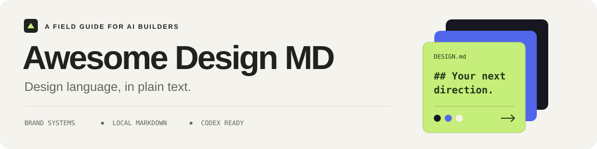
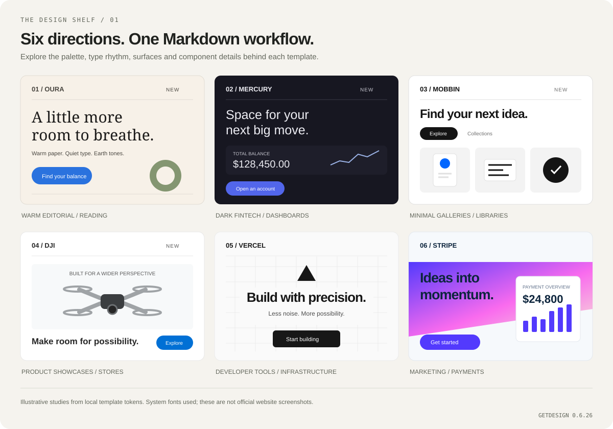

<div align="center">



# Awesome Design MD

**Turn a brand's design language into Markdown your coding assistant can use.**

86 brand templates · Local use · Codex and Antigravity

[](awesome-design-md/references/templates/manifest.json) [](https://www.npmjs.com/package/getdesign) [](https://github.com/taffy-owo/codex-skill-awesome-design-md/actions/workflows/test.yml) [](LICENSE)

[中文](README.md) / **English**

[Preview](#design-preview) · [Quick start](#quick-start) · [Choose a direction](#choose-a-direction) · [All templates](#all-templates) · [Maintenance](#maintenance)

</div>

## Start with a design direction

Choose a `DESIGN.md` for your landing page, dashboard, content product or components. Your coding assistant can follow its colors, typography, spacing, components and responsive rules. Templates come from the official [`getdesign`](https://www.npmjs.com/package/getdesign) package by [VoltAgent/awesome-design-md](https://github.com/VoltAgent/awesome-design-md). This snapshot contains **86 templates from version 0.6.26**.

| Choose a direction | Add it to your project | Build with it |
| --- | --- | --- |
| Browse by product and visual character | The CLI writes a `DESIGN.md` | Ask your assistant to read it before editing UI |

Applying bundled templates requires no API key or network connection. Installing the skill and refreshing upstream require network access.

## Design preview



These illustrations use local template colors and component rules, with system fonts replacing brand fonts. Read each linked template for the complete specification.

### New references to explore

| Template | Details to borrow | Good starting points |
| --- | --- | --- |
| [Oura](awesome-design-md/references/templates/oura.md) | Warm paper, editorial serif, earth tones and quiet space | Reading, lifestyle and content pages |
| [Mercury](awesome-design-md/references/templates/mercury.md) | Ink-violet surfaces, indigo action pills and light typography | Dashboards, finance and professional tools |
| [Mobbin](awesome-design-md/references/templates/mobbin.md) | White galleries, monochrome hierarchy and pill filters | Libraries, portfolios and template browsers |
| [DJI](awesome-design-md/references/templates/dji.md) | Product sections, engineering-blue actions and clear specifications | Product pages, stores and device showcases |
| [NerdWallet](awesome-design-md/references/templates/nerdwallet.md) | Deep spruce, mint washes and compact comparisons | Comparison, filtering and decision tools |
| [Discord](awesome-design-md/references/templates/discord.md) | Deep indigo, bold display type and Blurple gradients | Community and event pages |
| [Nintendo 2001](awesome-design-md/references/templates/nintendo-2001.md) | Y2K metal panels, amber navigation and pixel details | Retro themes and creative features |

Also added: `1win`, `aljazeera`, `jobright`, `mydealz`, `oracle` and `sap`. All 13 additions are in the local manifest. This upstream release also updates `notion` and `vercel`.

## Quick start

Requires **Python 3.10+**. Run these commands from the **repository root**. Everyday CLI use needs no extra Python packages.

```bash
git clone https://github.com/taffy-owo/codex-skill-awesome-design-md.git
cd codex-skill-awesome-design-md

# Find a template
python awesome-design-md/scripts/apply_template.py list --match oura

# Write DESIGN.md into your project
python awesome-design-md/scripts/apply_template.py install oura --project /path/to/your-project
```

Then ask your coding assistant:

> Read DESIGN.md in the project root. Use its colors, typography, spacing and component rules to improve the interface. Preserve existing functionality and check narrow layouts and keyboard access.

Replace `--project` with your project path; quote Windows paths that contain spaces. An existing `DESIGN.md` is protected. Add `--force` only when you intend to replace it.

### Install as a Codex skill

Send this request in Codex:

```text
Use skill-installer to install the awesome-design-md skill from taffy-owo/codex-skill-awesome-design-md.
```

You can also copy the `awesome-design-md/` folder into your configured Codex skills directory. Restart Codex after installation.

<details>
<summary>Antigravity and more CLI examples</summary>

Install into Antigravity from the repository root:

```bash
python awesome-design-md/scripts/install_to_antigravity.py
python awesome-design-md/scripts/install_to_antigravity.py --antigravity-home /path/to/antigravity
```

List everything, export JSON, choose an output file or replace an existing file:

```bash
python awesome-design-md/scripts/apply_template.py list
python awesome-design-md/scripts/apply_template.py list --json
python awesome-design-md/scripts/apply_template.py install linear --out /path/to/project/docs/DESIGN.md
python awesome-design-md/scripts/apply_template.py install stripe --project /path/to/project --force
```

Aliases include `linear` → `linear.app`, `mistral` → `mistral.ai` and `xai` → `x.ai`.

</details>

## Choose a direction

| Your product | Start here | Why explore it |
| --- | --- | --- |
| Reading and content | [Oura](awesome-design-md/references/templates/oura.md) · [Notion](awesome-design-md/references/templates/notion.md) · [WIRED](awesome-design-md/references/templates/wired.md) | Reading hierarchy, space and editorial rhythm |
| Developer tools and infrastructure | [Vercel](awesome-design-md/references/templates/vercel.md) · [Warp](awesome-design-md/references/templates/warp.md) | Precise structure and technical content |
| SaaS and workspaces | [Linear](awesome-design-md/references/templates/linear.app.md) · [Cal](awesome-design-md/references/templates/cal.md) | Low distraction and clear hierarchy |
| Dark dashboards | [Mercury](awesome-design-md/references/templates/mercury.md) · [Supabase](awesome-design-md/references/templates/supabase.md) | Layered surfaces and restrained accents |
| Galleries and resource browsers | [Mobbin](awesome-design-md/references/templates/mobbin.md) · [Pinterest](awesome-design-md/references/templates/pinterest.md) | Collection browsing, filters and visual discovery |
| Marketing and product pages | [Stripe](awesome-design-md/references/templates/stripe.md) · [DJI](awesome-design-md/references/templates/dji.md) · [Framer](awesome-design-md/references/templates/framer.md) | Narrative rhythm, calls to action and showcases |

These are suggestions based on product fit. Keep an established design system where appropriate, and check brand font licenses and available fallbacks before use.

## All templates

<details>
<summary>Browse all 86 brands</summary>

### AI and LLM platforms

`claude` · `cohere` · `elevenlabs` · `jobright` · `minimax` · `mistral.ai` · `ollama` · `opencode.ai` · `replicate` · `runwayml` · `together.ai` · `voltagent` · `x.ai`

### Developer tools and IDEs

`cursor` · `expo` · `lovable` · `raycast` · `superhuman` · `vercel` · `warp`

### Backend, databases and DevOps

`clickhouse` · `composio` · `hashicorp` · `mongodb` · `oracle` · `posthog` · `sanity` · `sentry` · `supabase`

### Productivity and SaaS

`cal` · `intercom` · `linear.app` · `mintlify` · `notion` · `resend` · `sap` · `zapier`

### Design and creative tools

`airtable` · `clay` · `figma` · `framer` · `miro` · `mobbin` · `webflow`

### Fintech and crypto

`binance` · `coinbase` · `kraken` · `mastercard` · `mercury` · `nerdwallet` · `revolut` · `stripe` · `wise`

### Collaboration and community

`discord` · `slack`

### Commerce and retail

`airbnb` · `meta` · `mydealz` · `nike` · `shopify` · `starbucks`

### Media and consumer technology

`1win` · `aljazeera` · `apple` · `dji` · `hp` · `ibm` · `nvidia` · `oura` · `pinterest` · `playstation` · `spacex` · `spotify` · `theverge` · `uber` · `vodafone` · `wired`

### Automotive

`bmw` · `bmw-m` · `bugatti` · `ferrari` · `lamborghini` · `renault` · `tesla`

### Retro web

`dell-1996` · `nintendo-2001`

</details>

See [manifest.json](awesome-design-md/references/templates/manifest.json) for filenames, descriptions, content hashes and available upstream commit information.

Templates cover nine areas: visual theme, color roles, typography, components, layout, depth, design guardrails, responsive behavior and agent prompts. Some also include machine-readable design tokens.

## Maintenance

Maintainers need Python, Git and npm. From the repository root:

```bash
python awesome-design-md/scripts/sync_upstream.py
python -m pip install pytest
python -m pytest tests/ -q
```

The synchronizer downloads `getdesign@latest` into a temporary directory, verifies template hashes and keeps only manifest-listed Markdown plus [source metadata](awesome-design-md/references/upstream/sources.json). The GitHub commit is recorded separately; installed template content follows the published npm package. Unchanged sources do not create timestamp-only commits.

This snapshot corrects stray prose in one published Vercel `fontWeight` token. Its manifest entry retains the original content hash as `upstreamTemplateHash`; `templateHash` identifies the corrected local file. The correction matches only the affected upstream revision.

A weekly workflow opens a PR for review. Its commit scope is limited to templates and source metadata.

```text
awesome-design-md/
├── SKILL.md
├── agents/openai.yaml
├── scripts/                 # List, install and sync
└── references/
    ├── templates/           # DESIGN.md files and manifest.json
    └── upstream/sources.json

docs/assets/                 # Lightweight README SVGs
tests/                       # CLI and sync regression tests
.github/workflows/           # Tests and scheduled sync
```

Published files exclude full upstream snapshots, duplicate npm packages, archives and runtime caches. Report template issues through [Issues](https://github.com/taffy-owo/codex-skill-awesome-design-md/issues). Run tests and review the file list before submitting changes. See [CHANGELOG.md](CHANGELOG.md) for updates.

## Sources and acknowledgments

- [VoltAgent/awesome-design-md](https://github.com/VoltAgent/awesome-design-md) and [getdesign](https://www.npmjs.com/package/getdesign): design templates and upstream releases.
- [Best-README-Template](https://github.com/othneildrew/Best-README-Template): inspiration for the introduction, preview and getting started structure.
- [readme.so](https://github.com/octokatherine/readme.so): inspiration for organizing only the documentation sections a project needs.
- [awesome-readme](https://github.com/matiassingers/awesome-readme): inspiration for visual previews and clear navigation.

[MIT License](LICENSE). Brand analyses are references; trademarks and brand assets belong to their respective owners. This project is not affiliated with those brands.
